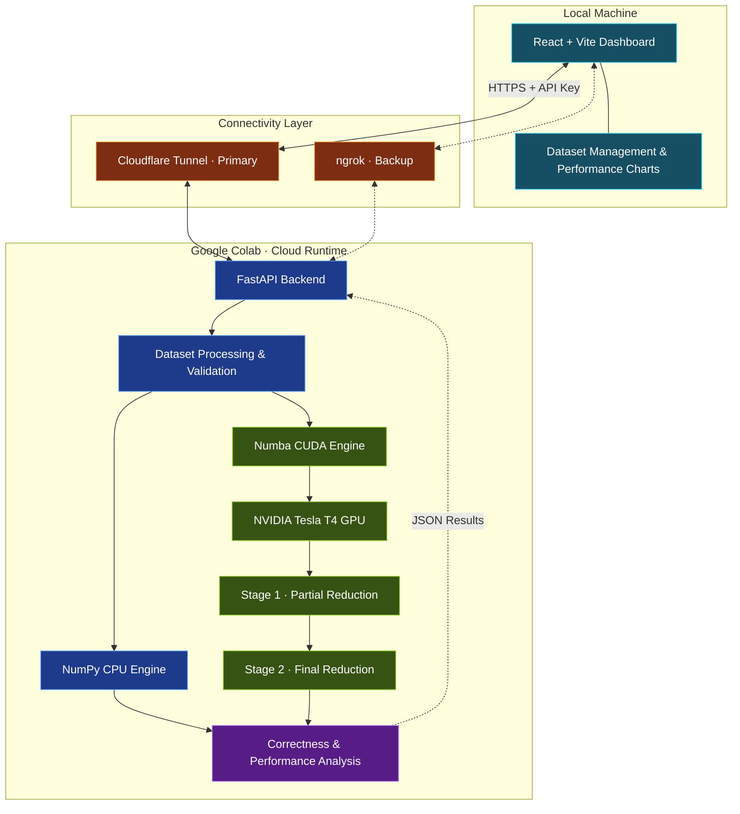
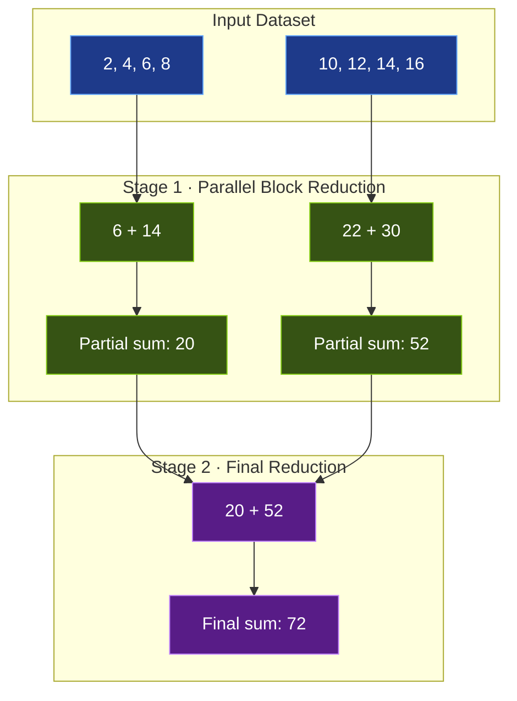

<div align="center">

# CUDA Parallel Reduction Engine

**GPU-accelerated aggregation and CPU vs GPU performance benchmarking**


[Overview](#overview) · [Architecture](#system-architecture) · [CUDA Implementation](#how-parallel-reduction-works) · [Setup](#getting-started) · [Benchmarks](#performance-analysis)

</div>

---

## Overview

A GPU-accelerated aggregation engine built using CUDA, Python and React to explore parallel reduction and compare CPU and GPU performance on large datasets.

The project started as a CUDA implementation in Google Colab and was extended into a full-stack application where users can run aggregation operations, upload datasets and analyse execution times through an interactive dashboard.

<div align="center">

**4 aggregation operations** · **6 CUDA kernels** · **256 threads/block** · **Up to 50M elements***

</div>

*Dataset capacity depends on available memory; large-scale GPU benchmarks are pending validation.*

## Features

- GPU-based sum, minimum, maximum and average operations
- Two-stage parallel reduction using shared memory
- CPU vs GPU execution time and speedup comparison
- Custom dataset generation and CSV uploads
- Benchmarks for datasets of up to 50 million elements, subject to available memory
- Result validation against a float64 reference
- GPU monitoring, kernel launch details and execution charts
- Remote GPU execution using Google Colab

## Tech Stack

| Component | Technology |
| --- | --- |
| GPU computing | CUDA, Numba |
| Backend | Python, FastAPI, Uvicorn |
| CPU computation | NumPy |
| Frontend | React, Vite |
| Visualization | Recharts |
| GPU environment | Google Colab (NVIDIA T4) |
| Connectivity | Cloudflare Tunnel / ngrok |

## System Architecture



The frontend runs locally, while the backend and CUDA kernels run on Google Colab. The frontend communicates with the backend through an HTTPS tunnel. Dataset generation, processing and GPU computation take place in Colab, so a CUDA-capable GPU is not required on the local machine.

## How Parallel Reduction Works

Instead of processing every element sequentially, the GPU distributes the work across multiple threads and blocks.

The implementation uses two stages:

1. **Partial reduction:** Each block processes a portion of the dataset and reduces its values using shared memory to produce one partial result.
2. **Final reduction:** A single block combines all partial results to produce the final output.



This is a simplified example of sum reduction. The actual implementation uses 256 threads per block and grid-stride loops to process larger datasets.

### CUDA Kernels

| Operation | Stage 1 | Stage 2 |
| --- | --- | --- |
| Sum | `partial_sum` | `final_sum` |
| Minimum | `find_min` | `final_min` |
| Maximum | `find_max` | `final_max` |
| Average | `partial_sum` | `final_sum` followed by division by N |

The six CUDA kernels from the original notebook are reused without modification in the backend.

The number of blocks is calculated based on the dataset size:

```python
threads = 256
blocks = max(1, min(1024, (n + threads - 1) // threads))
```

Grid-stride loops allow threads to process multiple elements even when the dataset is larger than the total number of launched threads.

## Project Structure

```text
CUDA-Parallel-Reduction-Engine/
│
├── backend/
├── frontend/
├── notebooks/
│   ├── CUDA_Parallel_Reduction_Engine.ipynb
│   ├── CUDA_Aggregation_Backend_Cloudflare.ipynb  ← Main
│   └── CUDA_Aggregation_Backend_Ngrok.ipynb       ← Optional backup
│
└── README.md
```

- `backend/` — CUDA kernels, FastAPI endpoints, dataset handling, benchmarking and validation.
- `frontend/` — React dashboard, charts and API integration.
- `notebooks/` — Original CUDA implementation and notebooks for running the backend on Colab.

## Getting Started

### 1. Prerequisites

- Google Colab with access to a CUDA-capable GPU
- Node.js (compatible LTS version)
- npm
- Git (optional, if downloading the repository as a ZIP)

### 2. Set Up the GPU Backend

1. Open [Google Colab](https://colab.research.google.com/).
2. Upload `notebooks/CUDA_Aggregation_Backend_Cloudflare.ipynb`.
3. Go to **Runtime → Change runtime type** and select **T4 GPU**.
4. Compress the `backend/` folder into `backend.zip` for the notebook's backend upload step.
5. Run the notebook cells in order, following the installation, upload and server setup prompts.
6. Copy the generated backend URL and API key.
7. Keep the Colab session running while using the application.

Cloudflare is the primary tunnel option. It does not require an account when using a quick tunnel.

#### Alternative: ngrok

If the Cloudflare tunnel does not work, use `CUDA_Aggregation_Backend_Ngrok.ipynb` instead.

Create an account on [ngrok](https://dashboard.ngrok.com/), add your authtoken to Colab Secrets as `NGROK_AUTHTOKEN`, enable notebook access and run the notebook cells.

### 3. Run the Frontend

Open a terminal in the project directory:

```bash
cd frontend
npm install
npm run dev
```

Open [http://localhost:5173](http://localhost:5173) in your browser.

Go to the **Connection** page, enter the backend URL and API key from Colab, and select **Save and test connection**.

The dashboard should display the connected GPU once the connection succeeds.

## Using the Application

1. Connect the dashboard to the Colab backend.
2. Select a preset dataset, generate a custom dataset or upload a CSV file.
3. Choose sum, minimum, maximum, average or all four operations.
4. Select the number of repetitions and run the computation.
5. Compare CPU and GPU results, execution times, speedup and correctness.

The Benchmarks page can be used to run the same operations across different dataset sizes. The GPU and Kernels page displays device information, kernel source and launch counters, and provides a GPU self-test.

## Performance Analysis

The application measures CPU execution time using NumPy and GPU execution time using CUDA events, with data transfer measured separately.

| Metric | Description |
| --- | --- |
| CPU time | Time taken by the NumPy operation |
| Kernel time | Execution time of both CUDA reduction stages |
| Transfer time | Time taken to copy the dataset to GPU memory |
| Total GPU time | Transfer, kernel execution and result readback |
| Kernel speedup | CPU time / GPU kernel time |
| Overall speedup | CPU time / total GPU time |

GPU execution is not always faster than CPU execution. For smaller datasets, memory transfer and kernel launch overhead can outweigh the benefits of parallel processing. The dashboard reports both kernel-level and overall speedup to make this comparison clear.

## Correctness and Testing

| Validation | Status |
| --- | --- |
| Kernel identity | Passed |
| Backend integration | Passed on CUDA simulator |
| Frontend integration | Passed locally |
| Physical GPU benchmarks | Pending |

CPU and GPU outputs are compared against a float64 reference. Minimum and maximum results must match exactly, while sum and average are checked using a floating-point tolerance.

The initial testing record includes:

- All six backend CUDA kernels matched against the original notebook.
- 32 backend integration tests passed using the CUDA simulator.
- Reduction correctness tested on datasets ranging from 1 to 100,000 elements, including negative values and non-power-of-two lengths.
- Frontend integration tested locally against the simulated backend.

Real GPU performance, million-element correctness tests and end-to-end Colab tunnel behaviour still require hardware validation. Simulator timings are not used as GPU benchmark results.

## API Endpoints

| Method | Endpoint | Description |
| --- | --- | --- |
| GET | `/api/health` | Backend health status |
| GET | `/api/gpu` | GPU information |
| GET | `/api/kernels` | Kernel details and launch counters |
| POST | `/api/selftest` | GPU correctness self-test |
| GET | `/api/datasets` | List datasets |
| POST | `/api/datasets/preset` | Load a preset dataset |
| POST | `/api/datasets/generate` | Generate a dataset |
| POST | `/api/datasets/upload` | Upload a CSV file |
| DELETE | `/api/datasets/{id}` | Delete a dataset |
| POST | `/api/compute` | Run aggregation operations |
| POST | `/api/benchmark` | Run a benchmark |

All endpoints except `/api/health` require the `X-API-Key` header. Keep API keys and tunnel credentials out of the repository.

## Limitations

- GPU availability and session duration depend on Google Colab.
- The tunnel URL and API key may change when the backend restarts.
- The implementation uses float32 arithmetic, which can introduce rounding errors in large reductions.
- Maximum dataset size depends on available host and GPU memory.
- The backend processes one GPU job at a time.
- Large CSV uploads may be limited by tunnel and backend configuration.

If the backend disconnects, restart the Colab backend and update the connection details in the dashboard. Datasets stored in Colab memory need to be loaded again after a runtime reset.

## What I Learned

This project helped me understand how CUDA threads, blocks, shared memory and grid-stride loops work together to perform parallel reductions. It also helped me explore the difference between kernel execution time and actual GPU computation cost, and how a GPU computing program can be integrated into a full-stack application.
